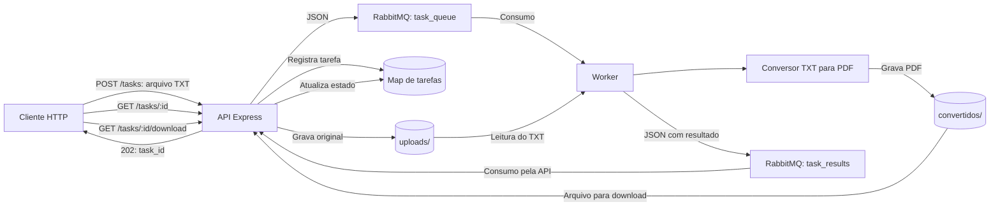
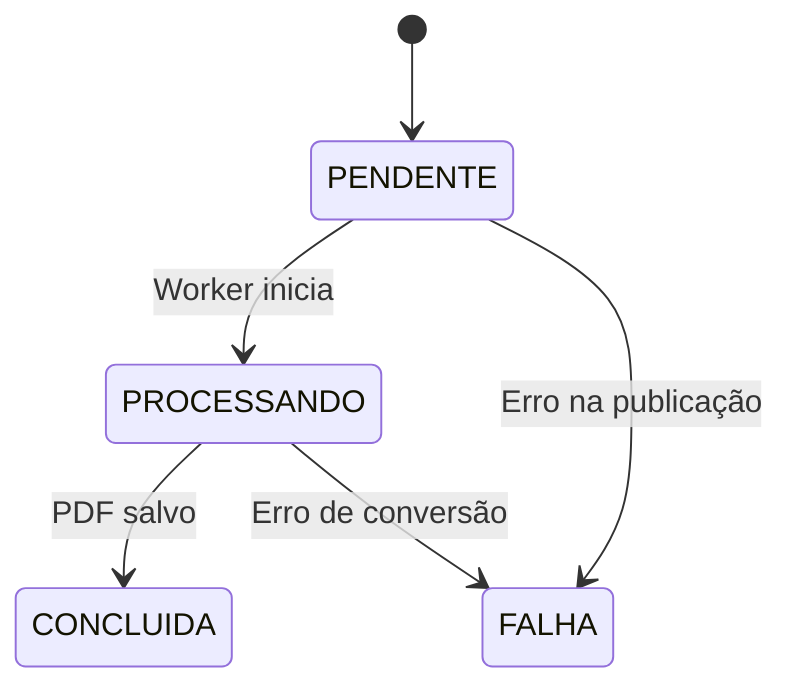

# File Conversion — Conversão assíncrona de TXT para PDF

Projeto da **Equipe 05**, da disciplina **CIN0143 — Introdução aos Sistemas Distribuídos e Redes de Computadores**, do CIn/UFPE.

O sistema evolui a APS de conversão com sockets TCP para uma **arquitetura orientada a eventos com Task Queue**. O cliente envia um TXT à API HTTP e recebe um identificador de tarefa sem aguardar a conversão. Um worker realiza o processamento em segundo plano; o cliente consulta o estado e baixa o PDF quando estiver disponível.

## Escopo e tecnologias

A conversão suportada é **TXT em UTF-8 → PDF**, com arquivos de entrada não vazios de até **10 MiB (10.485.760 bytes)**. Não são suportados DOCX, imagens, conversão inversa ou reprodução de formatação de outros documentos. O PDF é gerado com texto alinhado à esquerda e fonte de tamanho 12.

| Tecnologia | Responsabilidade e justificativa |
| --- | --- |
| TypeScript + Node.js | Tipagem dos modelos e execução dos componentes na mesma linguagem utilizada na APS. |
| Express | API HTTP organizada em rotas, controllers, serviços e middlewares. |
| Multer | Recebimento de arquivos multipart com limites de tamanho e quantidade. |
| RabbitMQ + amqplib | Desacoplamento entre recebimento e processamento, com filas de tarefas e resultados, confirmação de publicação e confirmação de consumo. |
| PDFKit | Geração dos documentos PDF, reutilizando a lógica da APS em um módulo de conversão. |
| JSON | Representação das respostas HTTP e das mensagens entre API e worker. |
| Docker Compose | Execução do RabbitMQ com volume persistente e painel de gerenciamento. API e worker ainda executam no host. |
| Arquivos locais + Map em memória | Armazenamento inicial simples, compatível com o escopo da Entrega 1. Redis é uma possibilidade futura, ainda não implementada. |

## Arquitetura e fluxo



1. O cliente envia um arquivo e solicita o formato `pdf`.
2. A API valida a requisição, gera um UUID, salva o original e cria uma tarefa `PENDENTE` em memória.
3. A API publica a tarefa em `task_queue` e aguarda a confirmação do broker.
4. A API responde `202 Accepted` com `task_id` e status, sem aguardar o worker.
5. O worker consome a tarefa, adquire o lock pelo `task_id` e publica `PROCESSANDO` com o horário de início.
6. O conversor lê o conteúdo UTF-8 e gera `convertidos/<task_id>.pdf`.
7. O worker publica a tarefa atualizada em `task_results`, como `CONCLUÍDA` ou `FALHA`, e registra a data de finalização.
8. A API consome o resultado e atualiza a tarefa no seu próprio `Map`.
9. O cliente consulta a tarefa e, se concluída, baixa o PDF pela API.

API e worker têm memórias independentes: as atualizações chegam à API pela fila de resultados. A API expõe `PROCESSANDO` na consulta HTTP enquanto a conversão estiver em andamento. Em tarefas rápidas, a consulta pode já retornar o estado final.

## Organização do código

```text
src/
├── server/
│   ├── app.ts
│   ├── server.ts
│   ├── controllers/tasks.controller.ts
│   ├── services/tasks.service.ts
│   ├── routes/tasks.routes.ts
│   └── middlewares/
│       ├── upload.middleware.ts
│       └── error.middleware.ts
├── tasks/
│   ├── task.model.ts
│   └── task.service.ts
├── broker/
│   ├── config.ts
│   ├── connection.ts
│   └── queue.ts
├── worker/worker.ts
├── converters/txtToPdf.ts
├── shared/
│   ├── constants/app.constants.ts
│   └── enums/
├── client/
└── test-rabbitmq.ts

docker-compose.yml
.env.example
package.json
package-lock.json
tsconfig.json
teste.txt
uploads/
convertidos/
```

O fluxo da API segue **Rotas → Controller → Service da API → Serviço de tarefas/Broker**. O controller concentra o HTTP; o serviço da API valida e coordena as operações; `tasks/task.service.ts` mantém o estado e os uploads. O worker importa o conversor, sem duplicar a implementação do PDFKit.

O middleware de erros traduz mensagens conhecidas de `MessagesEnum` para códigos HTTP; falhas inesperadas recebem uma resposta genérica. Falhas durante a transmissão do download também são encaminhadas ao tratamento de erros quando necessário.

O cliente em `src/client/` foi mantido como histórico da APS. **`npm run client` ainda utiliza TCP e não é compatível com a API HTTP atual.** Os exemplos de uso desta entrega utilizam `curl`.

## Modelagem do estado e armazenamento

As tarefas ficam em um `Map<string, Task>` na API, indexadas pelo UUID.

| Campo | Tipo/valores | Finalidade |
| --- | --- | --- |
| `task_id` | string UUID | Identificador único da tarefa. |
| `nome_arquivo` | string | Nome original usado para apresentação e nome do download. |
| `formato_origem` | `txt` | Formato de entrada suportado. |
| `formato_destino` | `pdf` | Formato de saída solicitado. |
| `status` | `PENDENTE`, `PROCESSANDO`, `CONCLUÍDA`, `FALHA` | Situação da tarefa. |
| `timestamps.criado_em` | string ISO 8601 em UTC | Criação da tarefa. |
| `timestamps.iniciado_em` | string ISO 8601 ou `null` | Início do processamento. |
| `timestamps.finalizado_em` | string ISO 8601 ou `null` | Finalização com sucesso ou falha. |
| `caminho_resultado` | string ou `null` | Caminho interno do PDF, preenchido em caso de sucesso. |



No diagrama, `CONCLUIDA` representa o valor JSON `CONCLUÍDA`.

Os arquivos são organizados por identificador:

```text
uploads/<task_id>.txt
convertidos/<task_id>.pdf
```

O nome original não é utilizado como caminho físico do upload, e UUIDs permitem separar arquivos de tarefas com nomes iguais. API e worker devem executar **na mesma raiz do projeto**, com acesso aos mesmos diretórios. O resultado publicado pelo worker contém um caminho relativo à raiz do projeto, que a API usa para localizar o PDF.

**Decisão de persistência desta entrega:** os arquivos permanecem no disco; o estado das tarefas permanece apenas em memória. Reiniciar a API perde esse estado, sem reconstrução a partir dos arquivos ou das filas. Resultados de IDs desconhecidos são ignorados. Não há expiração ou limpeza automática dos arquivos, recuperação do estado após reiniciar a API nem suporte a múltiplas instâncias da API compartilhando o estado.

## Contrato HTTP

Base local: **`http://localhost:3000`**. O servidor escuta em `0.0.0.0:3000`, conforme `app.constants.ts`.

| Método | Rota | Resposta de sucesso |
| --- | --- | --- |
| `GET` | `/health` | `200` com `{"status":"ok"}`. |
| `POST` | `/tasks` | `202` com `task_id` e `status`. |
| `GET` | `/tasks/:id` | `200` com o objeto completo da tarefa. |
| `GET` | `/tasks/:id/download` | `200` com `application/pdf` e `Content-Disposition: attachment`. |

### Criar tarefa

`POST /tasks` recebe `multipart/form-data`:

| Campo | Tipo | Regra |
| --- | --- | --- |
| `arquivo` | Arquivo | Obrigatório, exatamente um `.txt`, não vazio, válido em UTF-8, até 10 MiB. |
| `formato_destino` | Texto | Obrigatório, valor exato `pdf`. |

A extensão `.txt` é verificada sem distinção entre maiúsculas e minúsculas. O multipart permite um arquivo e um campo textual, de até 100 bytes. Campos adicionais ou arquivos em campos diferentes são rejeitados pelos limites do upload.

Exemplo de resposta:

```json
{
  "task_id": "1548d30a-4d6f-4b92-9f90-071e7d9ee0da",
  "status": "PENDENTE"
}
```

O `202` confirma o aceite e enfileiramento, não a conclusão da conversão. Se a publicação falhar, a tarefa é marcada como `FALHA` na memória e a API retorna `503`; essa resposta de erro não inclui o ID da tarefa.

### Consultar tarefa

`GET /tasks/:id` utiliza o `task_id` retornado no envio. Exemplo de resposta inicial:

```json
{
  "task_id": "1548d30a-4d6f-4b92-9f90-071e7d9ee0da",
  "nome_arquivo": "teste.txt",
  "formato_origem": "txt",
  "formato_destino": "pdf",
  "status": "PENDENTE",
  "timestamps": {
    "criado_em": "2026-11-17T18:00:00.000Z",
    "iniciado_em": null,
    "finalizado_em": null
  },
  "caminho_resultado": null
}
```

### Baixar resultado

`GET /tasks/:id/download` envia o PDF quando o estado é `CONCLUÍDA` e há resultado disponível. Para `teste.txt`, o nome sugerido no download é `teste.pdf`. O cliente pode repetir a consulta de status até a finalização.

### Erros

Formato das respostas de erro:

```json
{
  "erro": "Tarefa não encontrada."
}
```

| Código | Situação |
| --- | --- |
| `400` | Arquivo ausente, upload inválido, formato não suportado, arquivo vazio ou conteúdo UTF-8 inválido. |
| `404` | Tarefa não encontrada ou resultado ausente no download. |
| `409` | Download solicitado para uma tarefa que ainda não está concluída, inclusive em `FALHA`. |
| `413` | Arquivo maior que 10 MiB. |
| `500` | Falha inesperada, como erro de gravação em disco. |
| `503` | Falha de publicação no RabbitMQ durante a criação. |

`GET /health` verifica a resposta da API; não testa continuamente a saúde do broker ou do worker. A inicialização da API, entretanto, depende de conseguir conectar ao RabbitMQ e registrar o consumidor de resultados.

## Contrato de mensagens e filas

API e worker se comunicam por **AMQP**, usando as seguintes filas:

| Fila padrão | Produtor | Consumidor | Conteúdo |
| --- | --- | --- | --- |
| `task_queue` | API | Worker | Objeto `Task` em estado `PENDENTE`. |
| `task_results` | Worker | API | Objeto `Task` em `PROCESSANDO`, `CONCLUÍDA` ou `FALHA`. |

Os nomes são configuráveis por `TASK_QUEUE` e `RESULT_QUEUE`. Ambas as filas são declaradas com `durable: true`; as mensagens são publicadas com `persistent: true`, `contentType: application/json` e `messageId` igual ao `task_id`. A publicação usa um canal de confirmação e aguarda a confirmação do broker.

O payload de `task_queue` é o mesmo objeto completo mostrado no exemplo da consulta inicial. **Os bytes do arquivo não são enviados na mensagem**: o worker localiza o TXT em `uploads/<task_id>.txt`.

Exemplo de payload de `task_results` após sucesso:

```json
{
  "task_id": "1548d30a-4d6f-4b92-9f90-071e7d9ee0da",
  "nome_arquivo": "teste.txt",
  "formato_origem": "txt",
  "formato_destino": "pdf",
  "status": "CONCLUÍDA",
  "timestamps": {
    "criado_em": "2026-11-17T18:00:00.000Z",
    "iniciado_em": "2026-11-17T18:00:01.000Z",
    "finalizado_em": "2026-11-17T18:00:02.000Z"
  },
  "caminho_resultado": "convertidos/1548d30a-4d6f-4b92-9f90-071e7d9ee0da.pdf"
}
```

Em falha de conversão, o worker envia `status: FALHA`, `caminho_resultado: null` e timestamps preenchidos. A API atualiza uma tarefa existente. Uma atualização final exige timestamp de finalização e, em caso de sucesso, o caminho do PDF.

## Configuração e execução

### Pré-requisitos

- Node.js 22.18 ou superior compatível e npm.
- Docker com o daemon em execução e Docker Compose.
- Portas locais `3000`, `5672` e `15672` disponíveis.

Execute os comandos na raiz do repositório. Instale as dependências e configure o ambiente:

```bash
npm install
cp .env.example .env
npm run build
```

O arquivo de exemplo contém credenciais de desenvolvimento local. O `.env` é ignorado pelo Git.

| Variável | Padrão da aplicação | Uso |
| --- | --- | --- |
| `RABBITMQ_USER` | `guest` | Usuário AMQP e usuário inicial do container. |
| `RABBITMQ_PASS` | `guest` | Senha AMQP e senha inicial do container. |
| `RABBITMQ_HOST` | `localhost` | Host acessado pela API e pelo worker. |
| `RABBITMQ_PORT` | `5672` | Porta AMQP. |
| `TASK_QUEUE` | `task_queue` | Fila de conversões. |
| `RESULT_QUEUE` | `task_results` | Fila de resultados. |

O Compose usa as credenciais do `.env`; mantenha-as iguais às da aplicação. Usuário e senha iniciais são aplicados na criação do banco do RabbitMQ: alterar o `.env` não troca automaticamente credenciais de um volume já inicializado. A porta HTTP da API é uma constante e não é configurada por essas variáveis.

### Terminal 1 — RabbitMQ

```bash
docker compose up -d rabbitmq
docker compose logs -f rabbitmq
```

Aguarde a mensagem de inicialização concluída do RabbitMQ. `Ctrl+C` encerra apenas o acompanhamento dos logs; o container continua ativo.

O painel fica em **http://localhost:15672**, com as credenciais do `.env`. A porta `5672` é usada pela aplicação; `15672` é usada pelo painel.

### Terminal 2 — API

```bash
npm run server
```

A API registra o consumidor de `task_results` antes de começar a escutar em **http://localhost:3000**. Se o RabbitMQ ainda não estiver pronto, a inicialização falha: aguarde o broker e execute o comando novamente.

### Terminais 3 e 4 — Workers

```bash
npx tsx src/worker/worker.ts
```

Execute o comando nos dois terminais, na mesma raiz do projeto e com a mesma configuração de filas. Aguarde o evento `worker.waiting_for_tasks` em cada terminal.

Cada worker recebe uma tarefa por vez (`prefetch(1)`). Os workers compartilham `uploads/`, `convertidos/` e os locks em `uploads/.task-claims/`. O lock impede que dois workers convertam o mesmo `task_id` ao mesmo tempo, e o registro de conclusão permite ignorar duplicatas. Se o RabbitMQ reentregar a tarefa após a queda do worker, outro worker no mesmo computador pode recuperar o lock abandonado.

API e worker devem permanecer ativos durante o teste. O Compose atual executa **somente o RabbitMQ**; ainda não há Dockerfile ou serviços para API e worker.

## Teste do fluxo completo

Em outro terminal, na raiz do projeto:

Envie o TXT de exemplo:

Linux:
```bash
curl -i -X POST http://localhost:3000/tasks \
  -F "arquivo=@teste.txt" \
  -F "formato_destino=pdf"
```
Windows:
```bash
curl.exe -i -X POST http://localhost:3000/tasks `
  -F "arquivo=@teste.txt" `
  -F "formato_destino=pdf"
```

Esperado: `202` com o identificador. Copie esse valor:

Linux:
```bash
TASK_ID="COLE_O_TASK_ID_RETORNADO"
curl -i "http://localhost:3000/tasks/$TASK_ID"
```
Windows (PowerShell):
```powershell
$TASK_ID = "COLE_O_TASK_ID_RETORNADO"
curl.exe -i "http://localhost:3000/tasks/$TASK_ID"
```

Repita a consulta até aparecer `CONCLUÍDA`. O worker deve registrar a conclusão no terminal. Baixe o PDF:

Linux:
```bash
curl -f -o resultado.pdf "http://localhost:3000/tasks/$TASK_ID/download"
```
Windows:
```bash
curl.exe -f -o resultado.pdf "http://localhost:3000/tasks/$TASK_ID/download"
```

Abra `resultado.pdf` e confira o conteúdo, os acentos e as quebras de linha em relação ao TXT. O arquivo gerado pelo worker também estará em `convertidos/<task_id>.pdf`.

### Testes de estados e validações

| Teste | Resultado esperado |
| --- | --- |
| Enviar sem o campo `arquivo` | `400`. |
| Enviar arquivo com extensão diferente de `.txt` | `400`. |
| Enviar TXT vazio ou conteúdo UTF-8 inválido | `400`. |
| Enviar `formato_destino=docx` | `400`. |
| Enviar arquivo maior que 10 MiB | `413`. |
| Consultar `/tasks/nao-existe` | `404`. |
| Baixar uma tarefa pendente ou com falha | `409`. |
| Baixar uma tarefa concluída com resultado disponível | `200` e PDF. |

Para observar uma tarefa pendente, pare todos os workers com `Ctrl+C`, envie um TXT e consulte o ID. A API responde `202`, a tarefa permanece `PENDENTE` e o download retorna `409`. Reinicie o worker para consumir a mensagem e concluir a conversão.

Para verificar uma falha de conversão, com todos os workers parados, envie uma tarefa, remova somente o TXT de teste correspondente em `uploads/` e reinicie o worker. A tarefa deve terminar em `FALHA`, sem download disponível.

### Teste de concorrência

Com os dois workers ativos, repita o `POST /tasks` várias vezes em terminais diferentes. Consulte os IDs e baixe os PDFs como no exemplo acima. Compare `task_id` e `worker_pid` nos eventos `worker.processing_started` e `worker.conversion_succeeded` para acompanhar a distribuição das tarefas.

`npm test` verifica a disputa pelo mesmo ID, a recuperação de um lock abandonado e a espera por um lock ativo. Os testes executam processos separados e simulam a conversão e a publicação, sem precisar do RabbitMQ.

### Teste isolado do broker

Com o RabbitMQ e um worker ativos, execute na raiz do projeto:

```bash
npx tsx src/test-rabbitmq.ts
```

A cada execução, o script copia `teste.txt` para `uploads/<task_id>.txt`, publica na fila configurada em `TASK_QUEUE` e imprime o ID gerado. O worker deve gerar `convertidos/<task_id>.pdf`. Como o teste publica diretamente no broker, consulte o resultado no disco e nos logs do worker.

### Encerramento e diagnóstico

Encerre API e worker com `Ctrl+C`. Para parar o broker mantendo seu volume:

```bash
docker compose stop rabbitmq
```

- `ERR_MODULE_NOT_FOUND`: execute `npm install` na raiz antes de iniciar os componentes.
- Erro de conexão AMQP: confira o container, porta, host, credenciais e logs do RabbitMQ.
- Tarefa pendente: confira se há consumidor em `task_queue` e se o worker iniciou sem erros.
- Arquivo de entrada inexistente: execute API e worker na mesma raiz e confira `uploads/<task_id>.txt`.
- `404` após reiniciar a API: o estado em memória foi perdido, mesmo que o PDF continue no disco.
